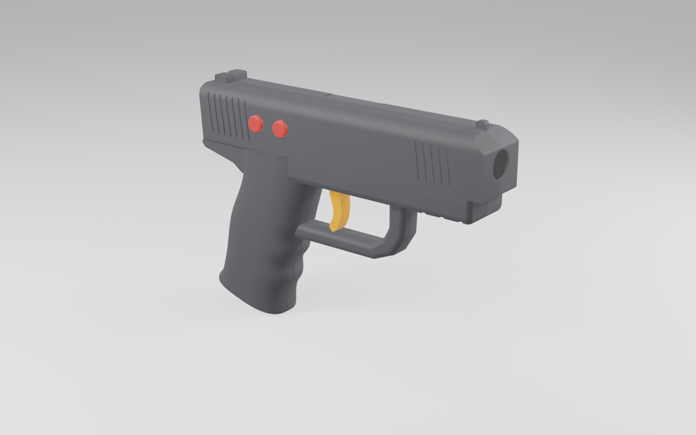
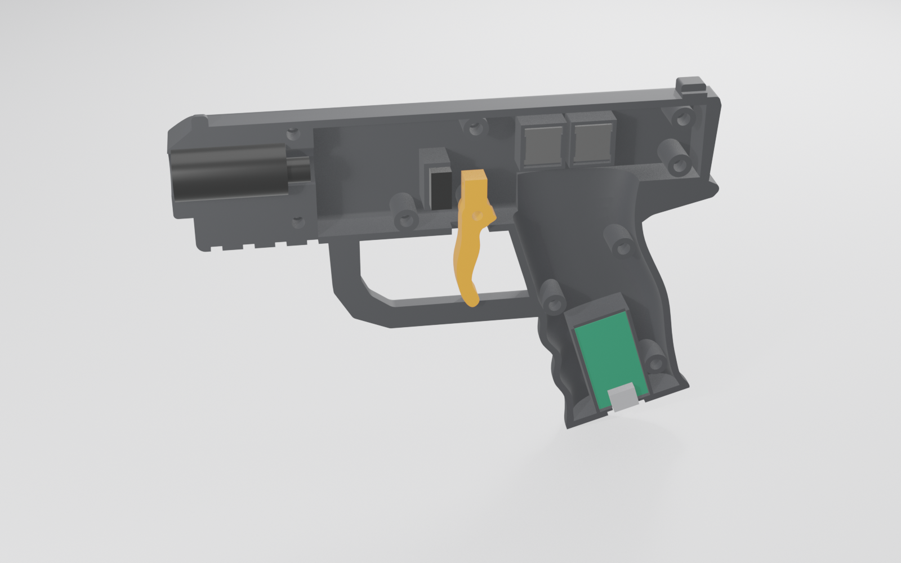
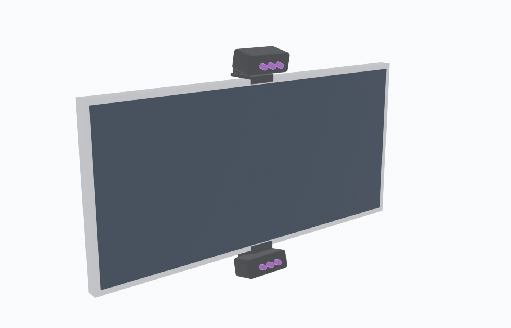
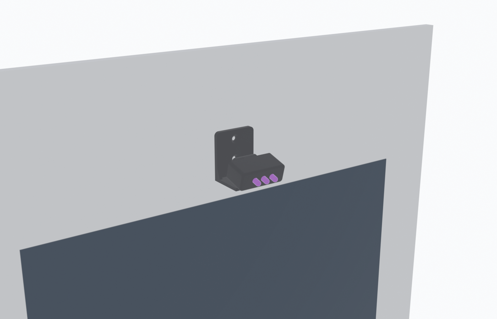
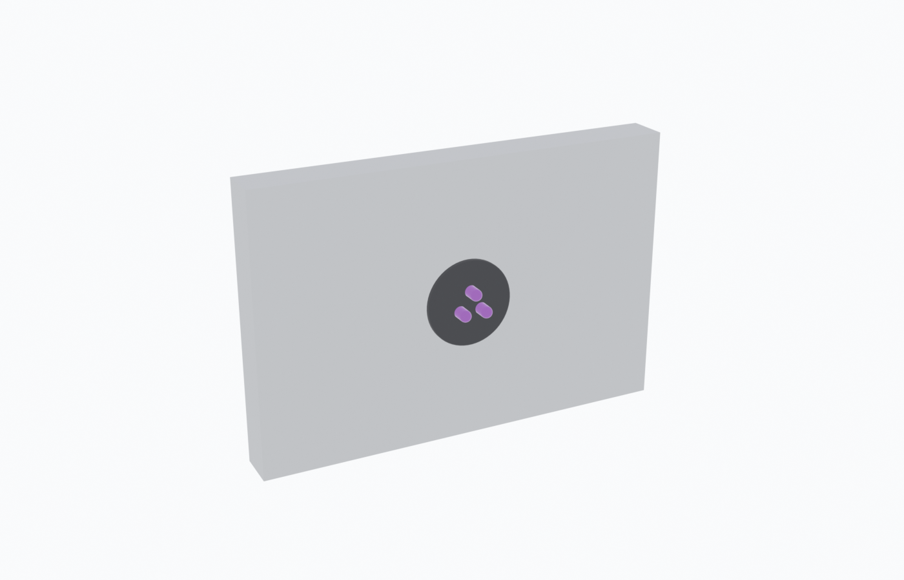

# ggCon V1: lightgun GUN4IR casera

Una pistola de luz para GUN4IR con Pro Micro USB-C, cámara IR DFRobot SEN0158, gatillo con microswitch y 4 botones, más los 4 emisores IR que van en la tele. Todo se imprime en una Bambu Lab A1 mini.
Esta versión es la básica: no tiene solenoide ni vibración.



| | |
|---|---|
|  |  |

Video del ensamblado: [`pistola/renders/ensamblado.mp4`](pistola/renders/ensamblado.mp4)

## Estructura
```
pistola/        modelo CAD (FreeCAD), renders y video (Blender), STL listos para imprimir
emisores_ir/    emisores IR modulares: cápsula + 5 soportes, circuito, guía por escenario
firmware/       sketch de prueba de cámara y botones (antes de cargar GUN4IR)
```
Los modelos son paramétricos. Si cambiás una medida arriba del script, regenerás con:
```
"D:\Program Files\FreeCAD 1.0\bin\FreeCADCmd.exe" pistola\pistola_fc.py
"D:\Program Files\FreeCAD 1.0\bin\FreeCADCmd.exe" emisores_ir\emisor_fc.py
"D:\Program Files\Blender Foundation\Blender 5.0\blender.exe" -b -P pistola\render_blender.py -- stills
```

---

## Lista de compras: todo en Candy-HO
Precios vistos el 17/11/2026. Pueden cambiar.

### ⚠️ Los LEDs IR no están publicados en Candy-HO
En la web de Candy-HO **no hay LEDs emisores infrarrojos** (ni de 940 ni de 850 nm, ni el módulo KY-005 suelto). Solo venden receptores y sensores.
Antes de comprar, **escribiles por WhatsApp** y preguntá si tienen sin publicar: *"LED emisor infrarrojo 940 nm 5 mm, x12"* (por ejemplo IR333C, TSAL6200 o SFH 4547).
Si no tienen, esos 12 LEDs son lo único que hay que conseguir en otro lado. Las cajas están diseñadas para **cualquier LED IR de 5 mm**.

### Pistola
| Qué | Cant. | Producto | Precio |
|---|---|---|---|
| Microswitch del gatillo | 2 (1 de repuesto) | [Microswitch SPDT con palanca 1A 125V, SKU 8184](https://candy-ho.com/producto/microswitch-final-de-carrera-spdt-palanca-roller-1a-125v-arduino/) | $590 c/u |
| Pulsadores 12×12×7,3 | 5 (1 de repuesto) | [Tact Switch B3F-4055, SKU 2506](https://candy-ho.com/producto/boton-switch-tact-b3f-4055-push-button-generico-12x12x7-3/) | $190 c/u |
| Cable para la pistola (si no tenés uno) | 1 | [Cable USB tipo C de 1 m, SKU 6601](https://candy-ho.com/producto/cable-usb-tipo-c-1-metro-generico/) | $2.732 |

### Emisores IR (4 cajas)
| Qué | Cant. | Producto | Precio |
|---|---|---|---|
| LEDs IR de 940 nm y 5 mm | 12 (mejor 15) | **Consultar por WhatsApp** (ver arriba) | – |
| Resistencias de 22 Ω y 1/4 W | 1 pack x10 | [Buscar "resistencia 22 ohm"](https://candy-ho.com/?s=resistencia+22+ohm&post_type=product) (carbón SKU 1415 o metal SKU 1431) | $410 |
| Cable de alimentación y para unir las cajas | 4 | [Cable USB tipo C de 1 m, SKU 6601](https://candy-ho.com/producto/cable-usb-tipo-c-1-metro-generico/). Se corta y se usan los hilos rojo y negro. Uno conserva la ficha USB-A para enchufar. | $2.732 c/u |
| Cinta doble faz | 1 | [Bifaz de 12 mm × 10 m, SKU 4920](https://candy-ho.com/producto/cinta-adhesiva-bifaz-doble-faz-12-mm-x-10-mts/) | $2.990 |
| Termocontraíble | 1 kit | [Kit de 127 piezas, SKU 6164](https://candy-ho.com/producto/kit-termocontraible-tubos-7-tamanos-combo-127-piezas/) | $4.770 |
| *Opcional:* conector para desenchufar cada caja | 4 | [JST RCY de 2 pines con cable, SKU 4025](https://candy-ho.com/producto/conector-jst-rcy-2-pines-pitch-2-5mm-siliconado-10cm/) | $490 c/u |
| *Opcional:* estaño | 1 | [Estaño 60/40 de 1 mm, 100 g, SKU 6179](https://candy-ho.com/producto/estano-en-rollo-1mm-60-40-0-1kg-soldadura-rollo-100gr/) | $15.561 |

**Total sin LEDs y sin opcionales:** unos $22.700, o $25.400 con el cable de la pistola.

### Lo que ya tenés
- Cámara DFRobot SEN0158
- Pro Micro USB-C
- Heat inserts M3: **22** en total (10 para la pistola y 12 para los emisores)
- Tornillos M3:
  - **18 × M3×10**: 9 para la pistola, 1 para el ajuste del gatillo y 8 para las tapas de los emisores
  - **1 × M3×25**: eje del gatillo
  - **4 × M3×16**: bisagra de cada emisor
- Licencia DIY de GUN4IR ([gun4ir.com](https://gun4ir.com))

---

## Pistola
Está modelada en FreeCAD, con lofts anatómicos en el mango: palm swell, 3 apoyos de dedos y la base ensanchada. Tiene cola de castor, corredera con el lomo redondeado, estrías, miras y riel. Mide 174 × 125 × 30 mm.

| Pieza | Medidas | Encastre |
|---|---|---|
| DFRobot SEN0158 | Plano oficial: Ø16,45 × 34,1 mm + cola de Ø7,69 × 7 mm | Va en un caño de Ø16,7, con labio adelante y escalón atrás |
| Pro Micro USB-C | Placa de 35,0 × 18,0 × 1,6 mm, USB-C de 9,0 × 3,3 mm que asoma 1,0 mm | Va sobre rieles con tope. El USB-C sale por la base del mango |
| Microswitch | 12,8 × 6,5 × 5,8 mm | Queda encerrado entre las dos mitades. El gatillo tiene un tornillo M3 de ajuste |
| Tact 12×12 | B3F-4055 | Entra a presión con clic, con un botón impreso encima |

Antes de imprimir, **medí con calibre** la cámara y el microswitch. Si no coinciden, ajustá `CAM_D` y `SW_*` en `pistola/pistola_fc.py`.

**Cableado**

| Función | Pin del Pro Micro |
|---|---|
| Cámara: rojo VCC / negro GND / amarillo SDA / verde SCL | VCC / GND / **2** / **3** |
| Gatillo (COM + NO del microswitch) | 4 → GND |
| A / B / Start / Select | 5 / 6 / 7 / 8 → GND |

**Impresión**
- Las mitades van con la cara exterior sobre la cama, que es como vienen los STL.
- Usá soportes **tree** solo desde la cama, para el guardamonte, la cola de castor y la curva del mango.
- PLA o PETG, 4 perímetros y 15 % de relleno gyroid.

**Armado**
1. Probá cámara y botones con `firmware/test_hardware`.
2. Poné los heat inserts en la mitad izquierda.
3. Meté la cámara, el Pro Micro, el gatillo con su tornillo de ajuste, el microswitch y los botones.
4. Cableá todo.
5. Cerrá con 9 × M3×10 y el eje M3×25, todos desde la derecha.

---

## Emisores IR: sistema modular
Son 4 **cápsulas** iguales, cada una con **3 LEDs IR de 5 mm en serie y una resistencia de 22 Ω**. Cada cápsula se monta sobre el **soporte** que corresponda a tu setup: tele finita, tele gruesa, tele colgada, proyector o arcade. Si cambiás de setup, cambiás solo el soporte y no volvés a soldar.

| | | |
|---|---|---|
|  |  |  |

- **[Índice de los emisores IR](emisores_ir/README.md)**: las 5 versiones (base, gancho, pared, arcade y hub) y el circuito.
- **[Guía por escenario](emisores_ir/escenarios.md)**: qué soporte usar en cada setup y cuánto inclinar las cápsulas.
- **[Ideas futuras](emisores_ir/versiones/ideas-futuras.md)**

**Antes de cerrar las cápsulas, probá los LEDs.** La luz IR no se ve a simple vista, pero la cámara del celular sí la muestra (en muchos celulares solo la cámara frontal). Si conseguís LEDs con otra tensión de trabajo (Vf), recalculá la resistencia: R = (5 − 3·Vf) / I, con I entre 40 y 70 mA.
