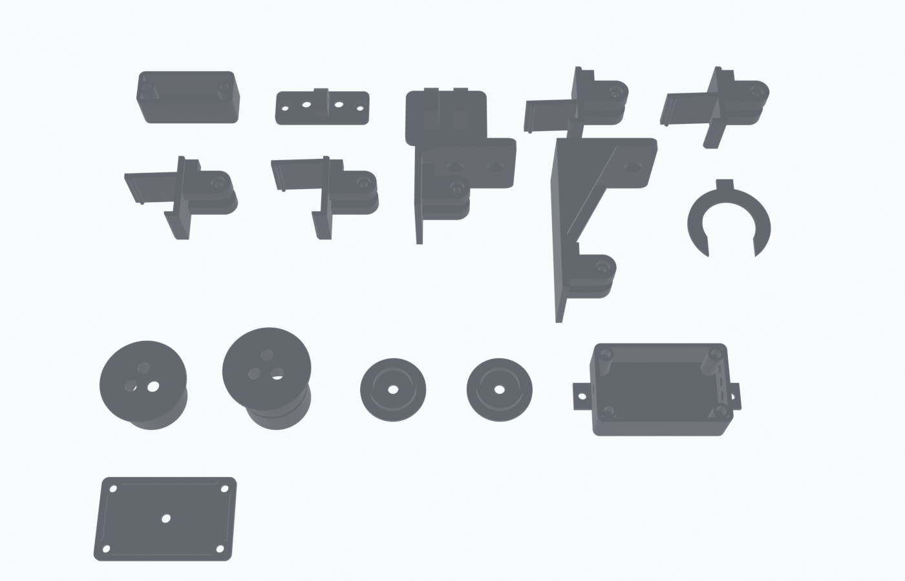
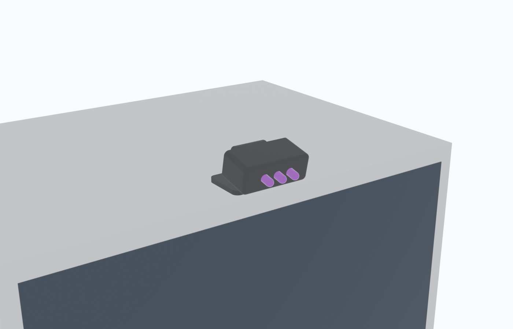
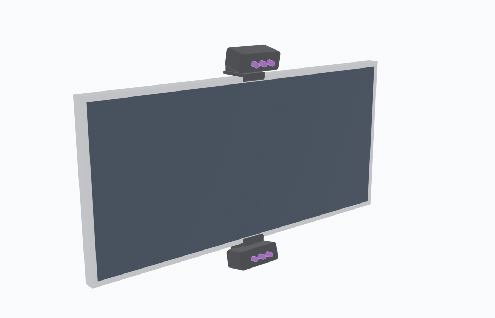
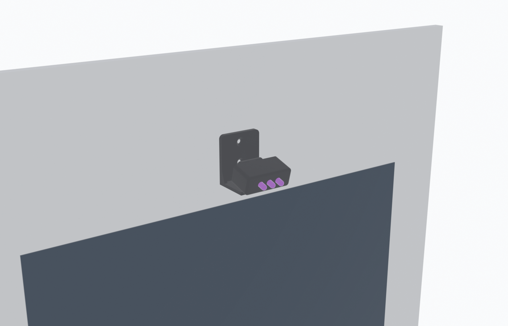
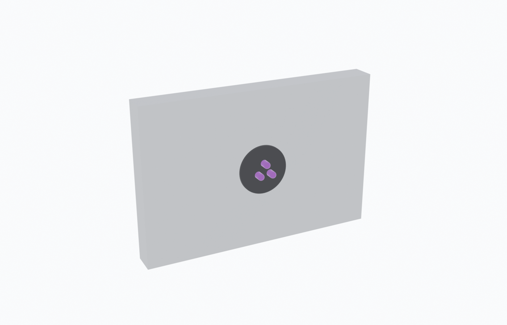
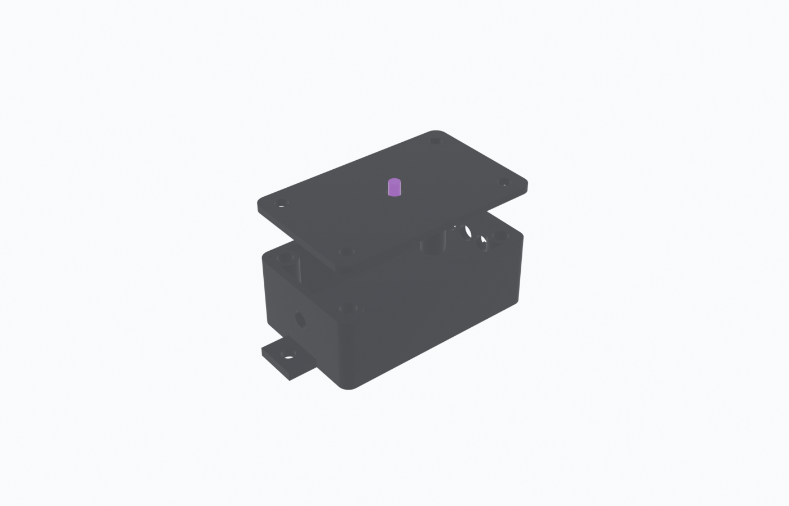
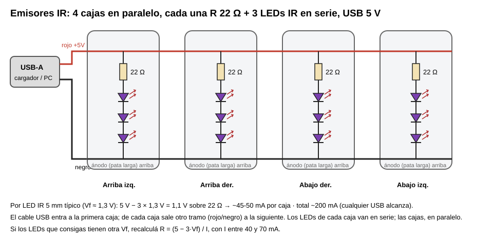

# Emisores IR: sistema modular

GUN4IR necesita **4 puntos IR** alrededor de la pantalla. La cámara de la pistola los ve y con ellos calcula adónde apuntás.
Acá cada punto es una **cápsula** con 3 LEDs IR. La cápsula se monta sobre un **soporte**, que se elige según dónde jugás: una tele finita, una tele gruesa, una tele colgada, un proyector o un mueble arcade.



## La idea: una cápsula y muchos soportes

```
          CÁPSULA (se suelda una sola vez)                 SOPORTES (se imprimen según el escenario)
   ┌──────────────────────────────┐                ┌──────────────┐  V1 base: mueble o tele gruesa
   │  ●  ●  ●   3 LEDs IR + 22 Ω  │── pestaña ──►  │  horquilla   │  V2 gancho: borde de tele finita
   └──────────────────────────────┘    M3 × 16     │  estándar    │  V3 pared: proyector o tele colgada
                                                   └──────────────┘
   V4 arcade: cápsula redonda que se empotra en un agujero de botón de 30 mm
   V5 hub: caja de empalme en estrella (1 USB entra, 4 cables salen)
```

Todos los soportes V1 a V3 terminan en la misma **horquilla estándar**, que tiene un eje M3 y un heat insert y hace de bisagra a fricción. Si cambiás de tele o te pasás a un proyector, imprimís otro soporte y **movés las mismas cápsulas sin volver a soldar**.

## Versiones

| | Versión | Para qué sirve | Ficha |
|---|---|---|---|
|  | **V1: base** | Arriba de una tele gruesa o vieja, o apoyada en el mueble | [01-base.md](versiones/01-base.md) |
|  | **V2: gancho** | Se cuelga del borde de una tele finita o un monitor, sin pegamento. Hay 4 tamaños | [02-gancho.md](versiones/02-gancho.md) |
|  | **V3: pared** | Se atornilla a la pared, para proyector o tele colgada. Tiene separador opcional | [03-pared.md](versiones/03-pared.md) |
|  | **V4: arcade** | Se empotra en un agujero de 30 mm en un bartop, mueble arcade o marco de madera | [04-arcade.md](versiones/04-arcade.md) |
|  | **V5: hub** | Caja de empalme para cablear en estrella en vez de en cadena | [05-hub.md](versiones/05-hub.md) |

- La cápsula y la horquilla se documentan en [00-capsula.md](versiones/00-capsula.md).
- **¿No sabés cuál usar?** Mirá la guía por escenario en [escenarios.md](escenarios.md).
- Las ideas que quedaron para más adelante están en [ideas-futuras.md](versiones/ideas-futuras.md).

## Circuito (igual para todas las versiones)
Cada cápsula lleva una resistencia de 22 Ω y 3 LEDs IR en serie. Las 4 cápsulas van en paralelo, alimentadas con 5 V desde un USB.


## Archivos
| Ruta | Qué es |
|---|---|
| `emisor_fc.py` | Modelo paramétrico de FreeCAD: todas las versiones, con los parámetros arriba de todo |
| `stl/` | Piezas listas para imprimir, ya orientadas en la cama. Las medidas están en `stl/medidas.json` |
| `escenas/` | Piezas posicionadas dentro de cada escena, solo para los renders |
| `render_emisor.py` | Renders de Blender |
| `renders/` | Imágenes |

Para regenerar todo:
```
"D:\Program Files\FreeCAD 1.0\bin\FreeCADCmd.exe" emisor_fc.py
"D:\Program Files\Blender Foundation\Blender 5.0\blender.exe" -b -P render_emisor.py
```
