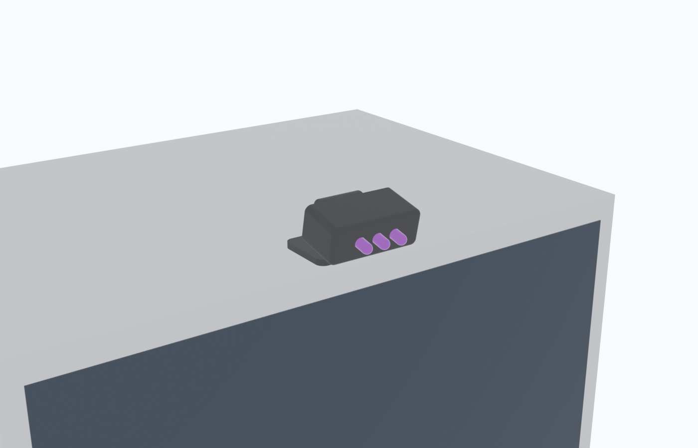

# V1: base con doble faz

Es una placa plana de 40 × 30 mm con la horquilla estándar. Es la versión más simple y la que más se adapta.

**Cuándo usarla**
- Arriba de una tele **gruesa o vieja** (LCD viejo, plasma, CRT) que tenga una superficie plana arriba.
- Apoyada en el **mueble** delante de la tele, para los 2 puntos de abajo.
- Sobre el escritorio, debajo de un monitor.

| Pieza | STL | Medidas | Impresión |
|---|---|---|---|
| Base | `v1_base.stl` | 40 × 30 × 25 mm | Plana, sin soportes |

**Material:** 1 heat insert M3 (en la oreja de la horquilla), 1 tornillo M3×16 y cinta doble faz (Candy-HO SKU 4920).

## Armado
1. Calentá el heat insert en la oreja de la horquilla que no tiene el rebaje para la cabeza.
2. Montá la cápsula con el M3×16 y regulá la inclinación.
3. Limpiá la superficie con alcohol y pegá la base con doble faz.

## Ventajas y contras
- ✅ La más simple: una pieza que se imprime en 25 minutos.
- ✅ Anda en cualquier superficie plana.
- ⚠️ Depende de la cinta. En plásticos texturados conviene una doble faz de espuma más gruesa.
- ⚠️ En una tele finita no hay superficie arriba. Para eso está la V2.

## Archivos en esta carpeta
| Archivo | Qué es |
|---|---|
| `capsula_cabezal.stl` | Cápsula: cabezal (la misma de [V0](../V0-capsula/README.md), copiada para que tengas todo acá) |
| `capsula_tapa.stl` | Cápsula: tapa con pestaña de bisagra (copia de V0) |
| `v1_base.stl` | Pieza para imprimir, ya orientada en la cama |
| `v1_tele_gruesa.png` | Render |

**Para un set de 4 emisores imprimí:** 4 × `capsula_cabezal.stl` + 4 × `capsula_tapa.stl` + 4 soportes de esta carpeta (o 2 de esta y 2 de otra variante, según tu [escenario](../escenarios.md)).
