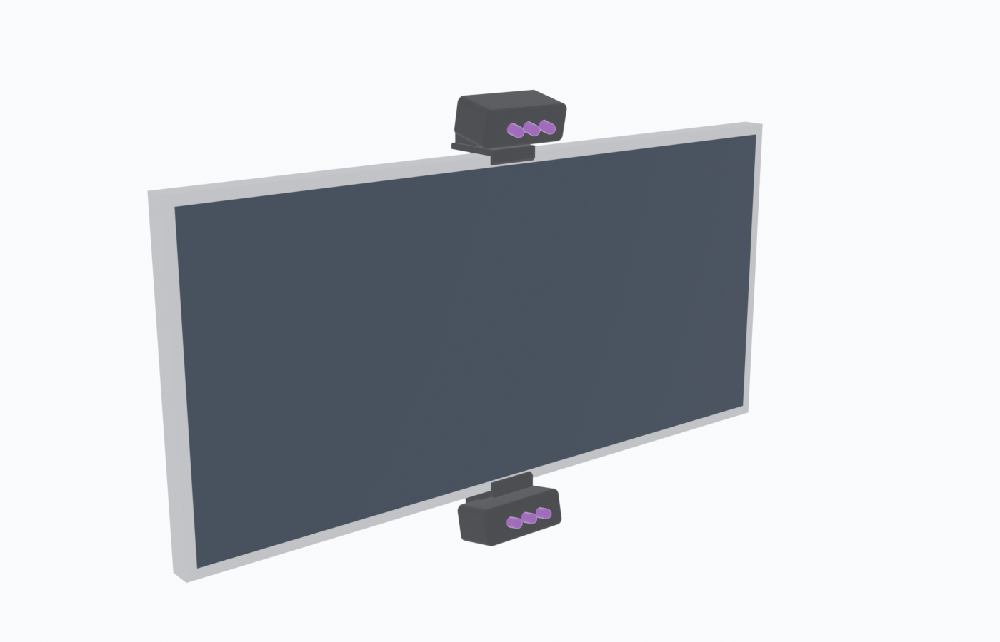
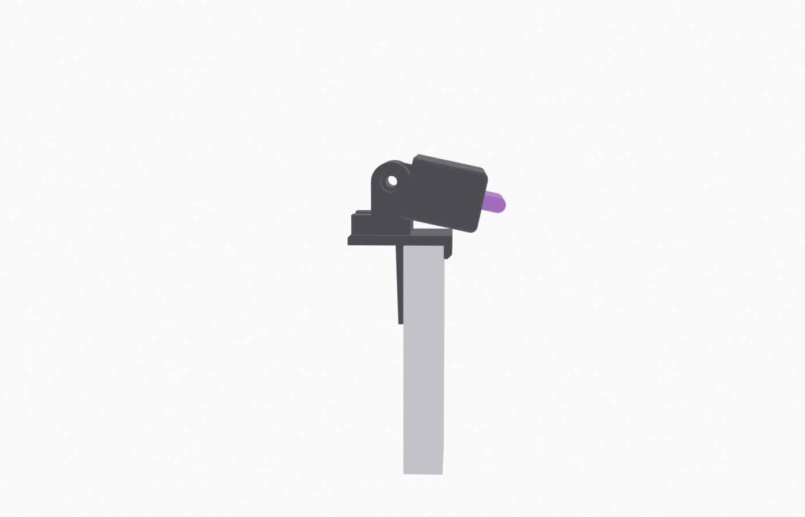

# V2: gancho para tele finita

| Montado | Perfil |
|---|---|
|  |  |

Es un clip que se cuelga del borde de la tele, **sin pegamento**:
- Un puente apoya sobre el borde superior.
- Adelante, una pestaña de 4 mm baja delante del marco, sin tapar la imagen.
- Atrás, un brazo de 24 mm baja por detrás de la tele. Viene cerrado 2° para que muerda como una pinza, y tiene un nervio de agarre en la punta.

**Cuándo usarla**
- En **teles finitas modernas** y **monitores**, para los 2 puntos de arriba.
- **Invertido** (girado 180°) abraza el borde de abajo. Sirve cuando no hay mueble; en ese caso agregá doble faz en el puente.

## Elegí el tamaño
Medí con calibre el **espesor del borde de arriba** de tu tele, de adelante hacia atrás. Mirá el borde mismo, no la parte de atrás, que suele ser más gruesa.

| STL | Espesor de tele | Ejemplos típicos |
|---|---|---|
| `v2_gancho_T08.stl` | 7 a 9 mm | Teles OLED o QLED de gama alta, monitores finos |
| `v2_gancho_T12.stl` | 11 a 13 mm | La mayoría de las teles LED actuales |
| `v2_gancho_T18.stl` | 16 a 19 mm | Teles LED económicas, monitores de oficina |
| `v2_gancho_T25.stl` | 23 a 26 mm | Teles de hace unos 10 años |

Si tu medida no está, cambiá `CLIP_T_LIST` en `emisor_fc.py`, por ejemplo `(10,)`, y regenerá.

**Impresión:** de costado, como viene el STL. Así las capas quedan a lo largo del brazo y no se quiebra al abrirlo. PLA o PETG, 4 perímetros, sin soportes. Es mejor PETG porque es más elástico. Mide 49 × 32 × 24 mm.

**Material:** 1 heat insert M3 y 1 tornillo M3×16. Opcional: un pedacito de goma o fieltro en el brazo trasero para no rayar la tele.

## Ventajas y contras
- ✅ No pega nada en la tele, se saca y se pone en un segundo.
- ✅ La cápsula queda unos 12 mm delante de la pantalla y 19 mm por encima del borde, a la vista de la cámara.
- ⚠️ Hay que medir. Si queda flojo, imprimí el tamaño de abajo (T−1).
- ⚠️ Invertido abajo aguanta, pero no está pensado para usarse mucho tiempo sin doble faz.

## Parámetros
| Parámetro | Valor | Qué controla |
|---|---|---|
| `CLIP_T_LIST` | 8, 12, 18, 25 | Espesores a exportar |
| `CLIP_LIP` | 4 | Cuánto baja la pestaña delantera |
| `CLIP_ARM` | 24 | Largo del brazo trasero |
| `CLIP_PINCH` | 2° | Cuánto se cierra el brazo. Más grados = más presión |

## Archivos en esta carpeta
| Archivo | Qué es |
|---|---|
| `capsula_cabezal.stl` | Cápsula: cabezal (la misma de [V0](../V0-capsula/README.md), copiada para que tengas todo acá) |
| `capsula_tapa.stl` | Cápsula: tapa con pestaña de bisagra (copia de V0) |
| `v2_gancho_T08.stl` | Pieza para imprimir, ya orientada en la cama |
| `v2_gancho_T12.stl` | Pieza para imprimir, ya orientada en la cama |
| `v2_gancho_T18.stl` | Pieza para imprimir, ya orientada en la cama |
| `v2_gancho_T25.stl` | Pieza para imprimir, ya orientada en la cama |
| `v2_gancho_perfil.png` | Render |
| `v2_tele_finita.png` | Render |

**Para un set de 4 emisores imprimí:** 4 × `capsula_cabezal.stl` + 4 × `capsula_tapa.stl` + 4 soportes de esta carpeta (o 2 de esta y 2 de otra variante, según tu [escenario](../escenarios.md)).
