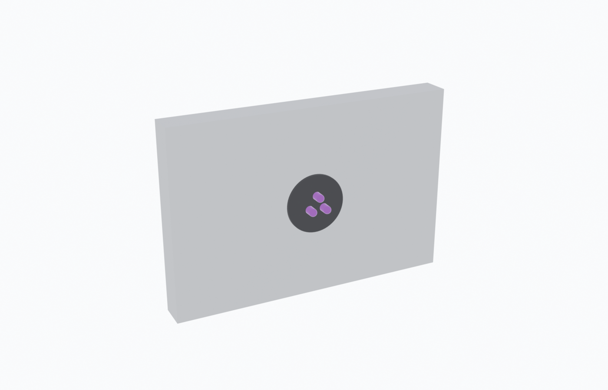
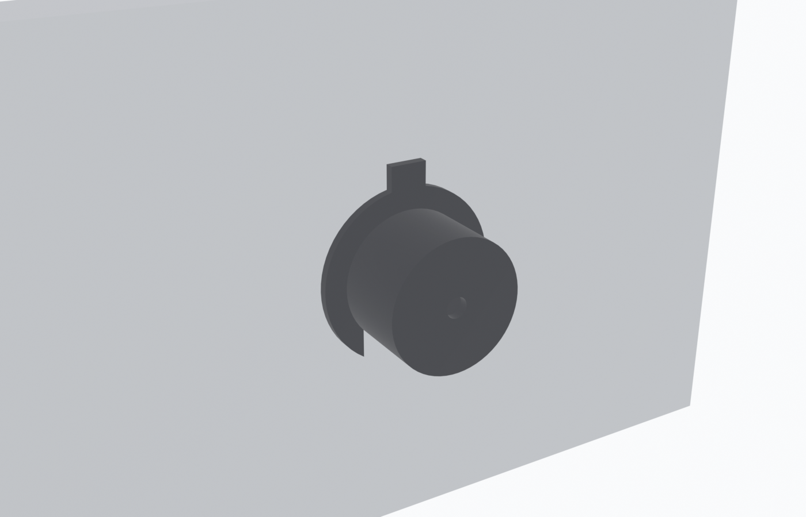

# V4: emisor empotrable para arcade

| Frente | Atrás (con el clip en C) |
|---|---|
|  |  |

Es una **cápsula redonda** que entra en un **agujero de 30 mm**, la medida estándar de un botón arcade.
- Adelante queda una brida de Ø37 mm con los 3 LEDs en triángulo.
- Atrás se traba con un **clip en C** que se calza a presión en una ranura.
- Una tapita trasera, también a presión, cierra la cápsula y deja pasar el cable.

No usa la horquilla: queda fija, mirando derecho hacia adelante.

**Cuándo usarla**
- En un **bartop o mueble arcade**, sobre el marco de madera o acrílico alrededor del monitor.
- En un **marco propio** alrededor de una tele, por ejemplo un bastidor de MDF.
- En cualquier panel donde puedas hacer un agujero de 30 mm, con mecha copa o Forstner.

| STL | Para qué |
|---|---|
| `v4_arcade_cuerpo_P03.stl` | Panel de 3 mm (acrílico, metal o MDF fino) |
| `v4_arcade_cuerpo_P18.stl` | MDF de 18 mm, el típico de un mueble arcade |
| `v4_arcade_tapa_P03.stl` y `_P18` | Tapa trasera a presión (las dos son iguales) |
| `v4_arcade_clip.stl` | Clip en C (sirve para los dos cuerpos) |

**Impresión:** el cuerpo va con la brida para abajo, así los agujeros de los LEDs quedan verticales y prolijos. El clip y la tapa van planos. Sin soportes.

**Material:** 3 LEDs IR, sus resistencias (3 de 100 Ω o 1 de 22 Ω, según el [circuito](../V0-capsula/README.md#circuito-elegí-según-tus-leds)) y cable. No lleva tornillos ni inserts.

## Armado
1. Hacé el agujero de 30 mm en el panel.
2. Metá los LEDs desde atrás en los agujeros del frente y soldalos con sus resistencias, igual que en la [cápsula](../V0-capsula/README.md).
3. Pasá el cable por la tapita, empujala hasta que entre y calzá el cuerpo en el panel desde adelante.
4. Por atrás, empujá el clip en C dentro de la ranura. Tiene una orejita para sacarlo.

## Ventajas y contras
- ✅ Queda integrado, como de fábrica.
- ✅ No se mueve ni se descalibra nunca.
- ⚠️ No se puede inclinar. En un arcade no importa, porque jugás de frente y a la altura de la pantalla.
- ⚠️ Hay que hacer un agujero en el mueble.

## Parámetros
| Parámetro | Valor | Qué controla |
|---|---|---|
| `ARC_HOLE` | 30 | Diámetro del agujero. Usá 24 si tu mueble tiene agujeros de botón de 24 mm |
| `ARC_PANELS` | 3, 18 | Espesores de panel a exportar |
| `ARC_LED_R` | 5,5 | Radio del triángulo de LEDs |

## Archivos en esta carpeta
| Archivo | Qué es |
|---|---|
| `v4_arcade_clip.stl` | Pieza para imprimir, ya orientada en la cama |
| `v4_arcade_cuerpo_P03.stl` | Pieza para imprimir, ya orientada en la cama |
| `v4_arcade_cuerpo_P18.stl` | Pieza para imprimir, ya orientada en la cama |
| `v4_arcade_tapa_P03.stl` | Pieza para imprimir, ya orientada en la cama |
| `v4_arcade_tapa_P18.stl` | Pieza para imprimir, ya orientada en la cama |
| `v4_arcade_atras.png` | Render |
| `v4_arcade_frente.png` | Render |

**Para un set de 4 emisores imprimí:** 4 × cuerpo (P03 o P18) + 4 × tapa + 4 × clip.
