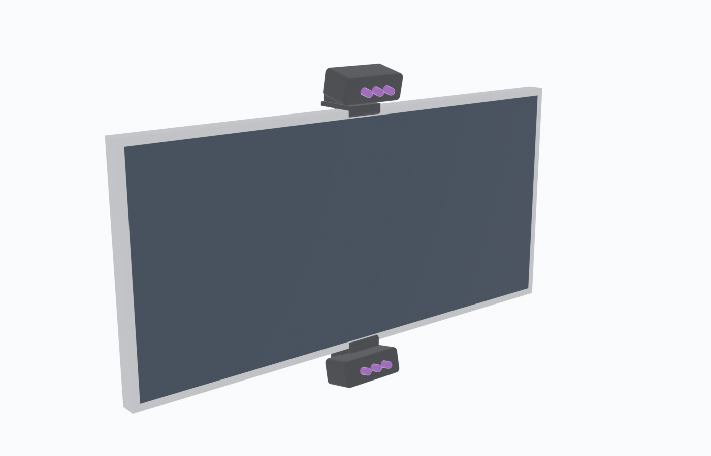
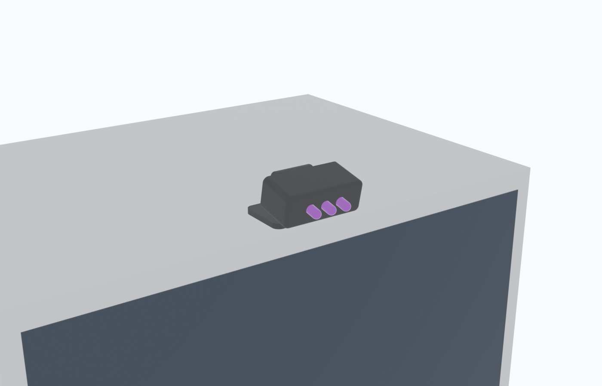
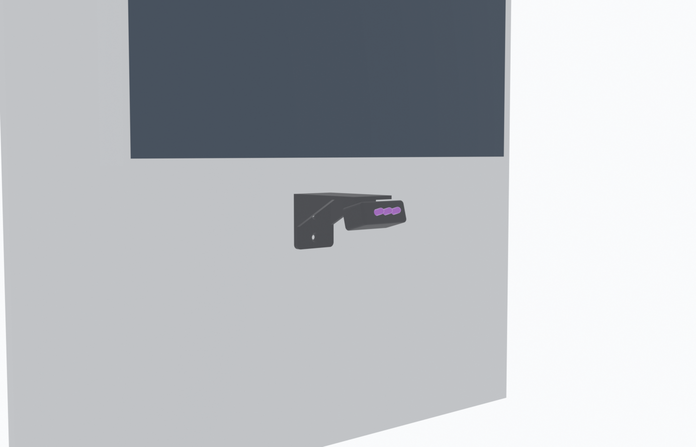
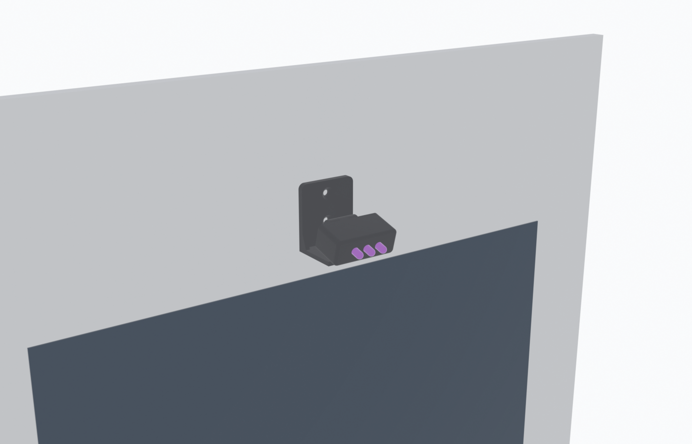
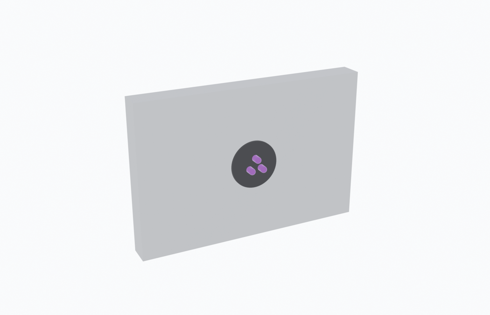

# Guía por escenario

Cada setup pide un soporte distinto. Buscá el tuyo en la tabla y después leé la ficha de esa versión.

| Escenario | Los 2 de arriba | Los 2 de abajo | Cableado |
|---|---|---|---|
| **Tele finita moderna en un mueble** | V2 gancho | V1 base apoyada en el mueble, o V2 gancho invertido | En cadena |
| **Tele finita colgada en la pared** | V2 gancho | V2 gancho invertido, o V3 pared con separador de 40 | Hub V5 detrás de la tele |
| **Tele vieja o gruesa (LCD viejo, plasma, CRT)** | V1 base pegada arriba | V1 base en el mueble | En cadena |
| **Proyector** | V3 pared sin separador | V3 pared (invertido) | Hub V5 y un power bank, o un cargador |
| **Monitor de PC** | V2 gancho (T08 o T12) | V1 base en el escritorio | En cadena, USB de la PC |
| **Bartop o mueble arcade** | V4 arcade en el marco | V4 arcade en el marco | Hub V5 adentro del mueble |
| **Tele con soporte de pie y sin mueble debajo** | V2 gancho | V2 gancho invertido, con doble faz | En cadena |

---

## Tele finita moderna
- El borde de arriba de una tele moderna mide entre 6 y 25 mm de espesor. **Medilo con calibre** e imprimí el gancho que corresponda: [T08, T12, T18 o T25](versiones/02-gancho.md).
- El gancho apoya sobre el borde superior. Adelante tiene una pestaña de 4 mm que tapa solo el marco, no la imagen. Atrás tiene un brazo que se cierra 2° para morder la tele.
- **Abajo:** si la tele está en un mueble, usá la V1 base apoyada delante de la tele. Si no hay mueble, poné el mismo gancho invertido, abrazando el borde inferior, con una tira de doble faz en el puente para que no se caiga.

## Tele vieja o gruesa
- Si arriba tiene una superficie plana de varios centímetros, la **V1 base** con doble faz es lo más simple.
- En un CRT conviene limpiar la carcasa con alcohol antes de pegar, porque suele tener polvo y grasa.
- Abajo, apoyá las bases en el mueble lo más cerca posible del borde inferior de la pantalla.

## Tele colgada en la pared
- Arriba va el gancho V2, igual que en una tele en mueble.
- **Abajo:** no hay mueble y el gancho invertido aguanta poco tiempo. Lo mejor es la **V3 pared con separador de 40 mm**, atornillada a la pared debajo de la tele. El separador trae la cápsula hacia adelante, así los LEDs quedan cerca del plano de la pantalla.
- El separador depende del soporte de la tele. Si tu tele queda a otra distancia de la pared, cambiá `WALL_STANDOFFS` en `emisor_fc.py`: con soportes fijos son unos 25 mm y con soportes inclinables 40 a 60 mm.
- Detrás de la tele conviene usar el **hub V5**: un solo cable USB baja hasta el hub y de ahí salen 4 cables cortos a cada cápsula.

## Proyector
- La tela o la pared es grande (80" a 120"), así que los LEDs quedan **lejos de la PC**. Usá la **V3 pared** sin separador, atornillada o con doble faz en las esquinas de la imagen.
- **Alimentación:** un power bank USB enchufado al hub V5 alcanza para varias horas, porque el consumo es de unos 200 mA. Así no tenés que tirar un cable USB largo hasta la PC.
- **La distancia importa:** en pantallas grandes conviene jugar a 2,5 o 3 m, para que los 4 puntos entren en el campo de visión de la cámara (33° horizontal y 23° vertical).
- Si la imagen del proyector tiene bordes negros, ubicá las cápsulas en el borde de **la imagen**, no de la tela.

## Bartop o mueble arcade
- Se hace un agujero de **30 mm**, el de un botón arcade estándar, en el marco de madera o acrílico alrededor del monitor. La V4 se empotra ahí y se traba por atrás con un clip en C.
- Hay dos largos: **P03**, para paneles de 3 mm (acrílico o metal), y **P18**, para MDF de 18 mm.
- No tiene inclinación: queda mirando derecho hacia adelante, que en un arcade es lo correcto.

---

## Ángulo de inclinación
Los LEDs tienen que apuntar hacia la altura de la pistola mientras jugás. El ángulo es aproximadamente `atan((altura del LED − altura de la pistola) / distancia)`:

| LED a | Pistola a | Distancia | Inclinación |
|---|---|---|---|
| 1,40 m (arriba de una tele de 55") | 1,10 m (sentado) | 2,0 m | unos 9° hacia abajo |
| 1,40 m | 1,40 m (parado) | 2,5 m | 0° |
| 0,70 m (abajo, en el mueble) | 1,10 m | 2,0 m | unos 11° hacia arriba |
| 2,00 m (arriba de la tela del proyector) | 1,20 m | 3,0 m | unos 15° hacia abajo |

La bisagra deja inclinar ±25°. Ajustá el M3×16 lo justo para que mantenga el ángulo.

## Ubicación de los 4 puntos
GUN4IR utils trae una **guía de colocación**. Seguí esa para las distancias exactas a las esquinas.
La regla general es esta: 2 puntos arriba y 2 abajo, **los 4 a la misma distancia del centro**, y lo más pegados al borde de la imagen que permita el soporte.
