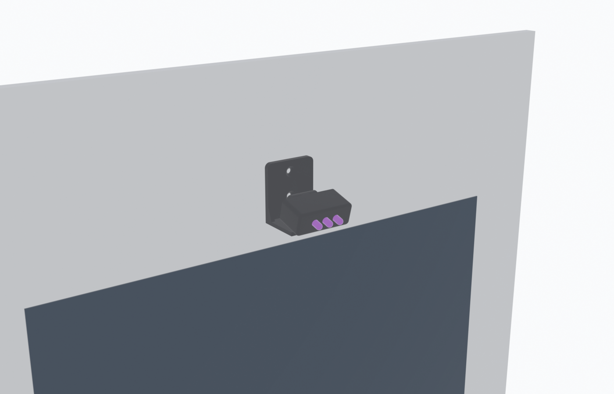
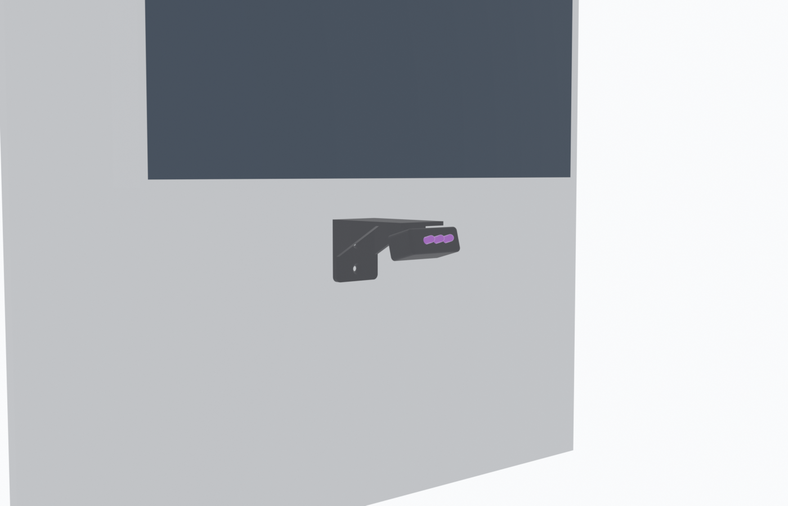

# V3: soporte de pared

| Proyector (S00) | Tele colgada (S40, invertido abajo) |
|---|---|
|  |  |

Es una placa que se atornilla a la pared, con un estante para la horquilla estándar y dos nervios que la refuerzan. Funciona **derecha**, arriba de la imagen, o **invertida**, abajo.

**Cuándo usarla**
- Con **proyector**: en las esquinas de la imagen, sobre la pared o el marco de la tela.
- Con **tele colgada**: debajo de la tele, donde no hay mueble, y también arriba si el gancho no te sirve.

| STL | Separador | Para qué |
|---|---|---|
| `stl/v3_pared_S00.stl` | 0 mm | Proyector o pared directa |
| `stl/v3_pared_S40.stl` | 40 mm | Tele colgada con un soporte que la separa unos 40 a 50 mm de la pared. Así los LEDs quedan cerca del frente de la tele |

Si tu soporte de pared deja la tele a otra distancia, cambiá `WALL_STANDOFFS` en `emisor_fc.py`. Por ejemplo `(0, 25, 60)`.

**Impresión:** de costado, como viene el STL. Los agujeros de los tornillos quedan horizontales y salen bien sin soportes. Tamaños: S00 de 46 × 34 × 40 mm y S40 de 46 × 74 × 40 mm.

**Material:**
- 1 heat insert M3 y 1 tornillo M3×16 para la horquilla.
- **Para la pared:** 2 tornillos para madera de 3,5 × 25 mm, con cabeza fresada, y 2 tarugos de 5 mm. Esto no lo vende Candy-HO: es de ferretería, o probablemente ya lo tengas en casa.
- **Sin agujerear:** la placa tiene 40 × 46 mm de superficie para doble faz de espuma. Sirve en pared lisa o en el marco de la tela.

## Ventajas y contras
- ✅ Firme, no se mueve aunque lo toques al pasar.
- ✅ El separador resuelve la tele colgada, que es el caso más difícil.
- ⚠️ Hay que agujerear la pared, salvo que uses doble faz.
- ⚠️ Con proyector, si movés el proyector o cambiás el zoom, hay que reubicar los puntos.

## Tip para proyector
Los LEDs quedan lejos de la PC. En vez de tirar un cable USB de 5 m, usá el **hub V5** con un **power bank**: 4 cápsulas consumen unos 200 mA, así que uno de 5000 mAh dura más de 20 horas.
