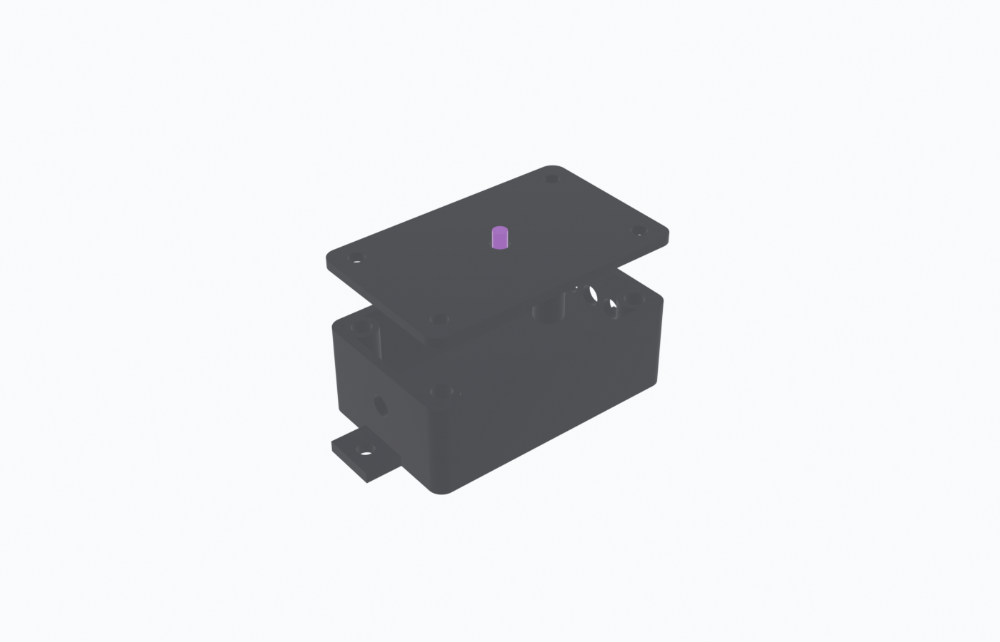

# V5: hub (caja de empalme)



Es una caja chica: **entra 1 cable USB y salen 4 cables**, uno por cápsula. Reemplaza el cableado en cadena por uno **en estrella**.

**Cuándo usarla**
- Con **tele colgada**: el hub va atrás, pegado o atornillado a la tele, y desde ahí salen 4 cables cortos.
- Con **proyector**: le enchufás un power bank y te olvidás de los cables largos.
- En un **mueble arcade**: va adentro del mueble.
- Siempre que quieras poder **desenchufar** cada cápsula por separado. En ese caso usá conectores JST RCY de 2 pines, Candy-HO SKU 4025.

| Pieza | STL | Medidas | Impresión |
|---|---|---|---|
| Caja | `stl/v5_hub_caja.stl` | 74 × 36 × 20 mm, con orejas | Boca arriba, sin soportes |
| Tapa | `stl/v5_hub_tapa.stl` | 58 × 36 × 3,5 mm | Plana |

**Material:** 4 heat inserts M3, 4 tornillos M3×10 y un pedazo de placa perforada (Candy-HO SKU 1796) o empalmes con termocontraíble.

**Opcional:** un LED rojo de 3 o 5 mm con una resistencia de 1 kΩ como **testigo de encendido**. La tapa tiene un agujero de Ø4 para ese LED. Es útil porque los LEDs IR no se ven.

## Cableado
```
USB (+5V rojo, GND negro) ──► [ barra +5V ] ──► rojo de las 4 salidas
                              [ barra GND ] ──► negro de las 4 salidas
                              (opcional: +5V ─ 1 kΩ ─ LED testigo ─ GND)
```
- Cada salida va a **una sola** cápsula. Las cápsulas ya traen su resistencia de 22 Ω adentro, así que en el hub no hace falta ninguna.
- Las orejas laterales tienen agujeros de Ø3,6 para tornillos de madera, o podés pegar el hub con doble faz.
